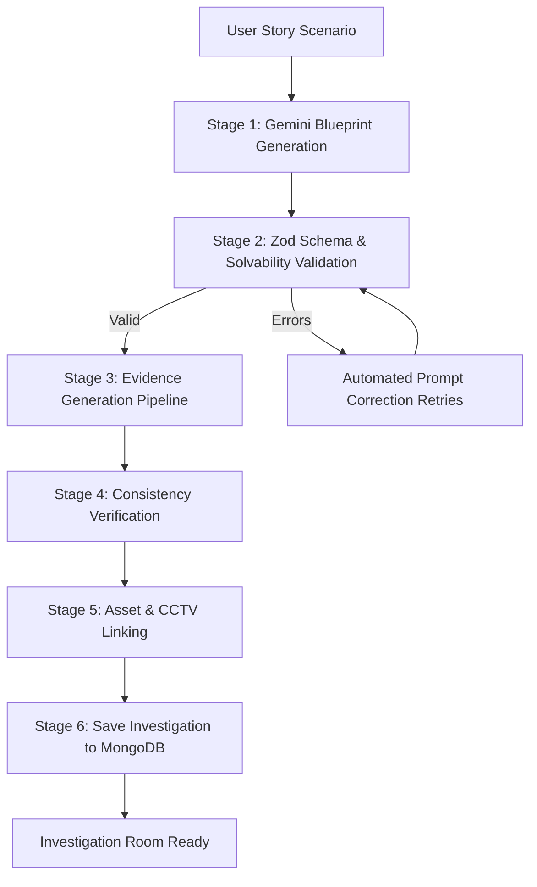
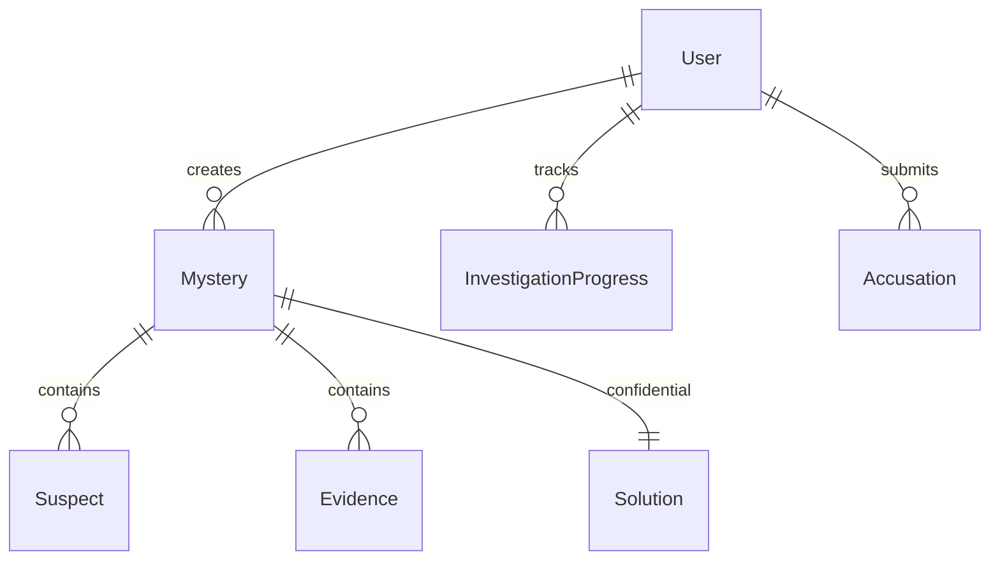

# AI Mystery Room - Architecture & System Design

## 1. Architectural Philosophy

AI Mystery Room is engineered according to **Spec-Driven Development (SDD)**. The core tenet is that **every generated mystery must be logically solvable**. Random hallucinations, unsolvable dead-ends, or multiple valid culprits are strictly prevented by a multi-stage validation pipeline.

---

## 2. Multi-Stage AI Pipeline

### Stage 1: Blueprint Generation
Rather than prompting AI to create individual clues independently, Gemini acts as a master puzzle architect generating a complete internal blueprint with:
- Case background & incident scene
- Suspect dossiers (motives, initial alibis, quirks)
- Ground-truth confidential solution (culprit ID, method, opportunity, motive)
- Chronological timeline
- Clue strategy & evidence plan

### Stage 2: Structural & Solvability Validation
Validated using Zod:
1. Exactly one intended culprit from the suspects list.
2. Unique suspect identifiers.
3. Minimum of 3 supporting clues connecting multiple evidence types.
4. Consistent timeline timestamps.

### Stage 3: Evidence Generation
Expands planned clues into immersive multi-format artifacts:
- **WhatsApp Messages:** Fictional dialogs with timestamps and suspicious slips.
- **CCTV Evidence:** Time-stamped surveillance stills with anomaly transcripts.
- **Witness Statements:** First-person depositions with subtle discrepancies.
- **Physical Clues & Documents:** Forensic notes, fingerprints, and audit records.

### Stage 4 & 5: Media & Confidentiality Isolation
- The `solutions` collection in MongoDB is completely isolated and strictly unreachable by client endpoints until after an indictment is filed.
- Suspect models returned to the frontend omit any culprit indicator flags.

---

## 3. Data Model Relationships

---

## 4. UI/UX Design System

- **Palette:** Premium detective dark workspace (`#0B0F14` dark base, `#121923` panel, `#18212D` card).
- **Accents:** `#D94B4B` (crime board red / thread) and `#D6A85F` (classified document brass / amber).
- **Typography:** `Space Grotesk` for titles and dossiers; `Inter` for investigative logs and legibility; monospace for timestamps and security codes.
- **Micro-Interactions:** CRT scanlines on surveillance monitors, clue bookmarking, and dynamic detective status chips.
